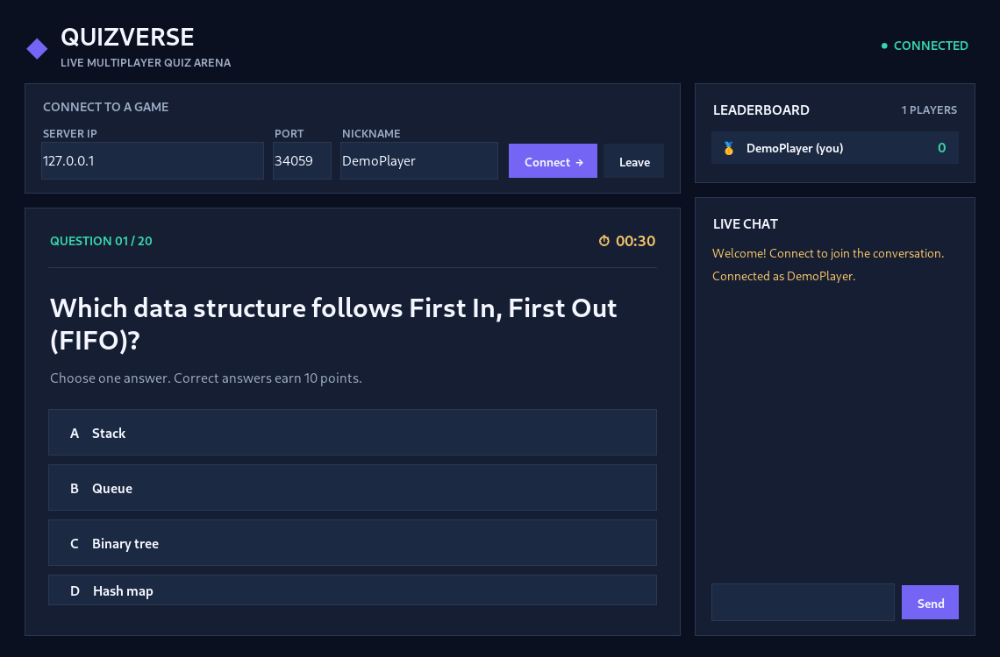

# QuizVerse — Real-Time Multiplayer Quiz System

A **desktop multiplayer quiz game** built with Python, TCP socket programming, multithreading, and Tkinter. One host runs the server; multiple players join with their own GUI windows (on the same computer or over a local network). The host controls rounds while the server synchronizes questions, answers, countdowns, scores, and a dedicated live chat.

> **Portfolio / learning project.** No external Python dependencies, no paid services, and no cloud account required. Designed for trusted LAN play—not for exposing directly to the public internet.



*Screenshot captured from the running Tkinter application with a local test server.*

## Features

- **Real-time client–server architecture:** UTF-8 JSON messages over TCP with newline framing
- **Multiplayer:** Concurrent players, unique nicknames, live player count and leaderboard
- **Desktop GUI:** Dark-themed Tkinter interface with answer choices, timer, scores, and chat
- **Synchronized questions:** Host-controlled start; automatic timer-driven round progression
- **Scoring:** 10 points for a correct answer, one answer per player per round
- **Dedicated chat:** Players can send and receive messages during the game
- **Host controls:** `start`, `next`, `stop`, `reset`, `reload`, `status`, `quit`
- **Question bank:** 20 original sample questions in editable `questions.json`
- **Automated tests:** Unit tests and socket-level integration tests
- **Robust shutdown:** TCP `SO_REUSEADDR` helps prevent address-in-use errors after a restart

## Project structure

```text
multiplayer-quiz-system/
├── client.py                # Tkinter desktop GUI and client event loop
├── server.py                # Multithreaded TCP quiz server + host CLI
├── network.py               # JSON-lines framing and socket I/O
├── quiz_core.py             # Quiz rules, validation, scoring, lifecycle
├── questions.json          # 20 editable sample questions
├── tests/
│   ├── test_quiz_core.py    # Unit tests
│   └── test_integration.py  # Real socket tests
├── start_server.bat         # Double-click on Windows
├── start_client.bat         # Double-click on Windows
├── requirements.txt        # Standard-library-only project
├── .gitignore
└── LICENSE
```

## Requirements

- Python **3.10 or newer**
- Windows 10/11, macOS, or Linux with Tkinter installed
- **No `pip install` required**: this project uses only the Python standard library
- For Linux, you may need to install `python3-tk` from your OS package manager

Check Python on Windows:

```powershell
py --version
```

If `py` is not recognized, try `python --version`. When using VS Code, open **File → Open Folder** and select this repository folder.

## Quick start — one Windows computer

### 1. Start the host server

Open **VS Code → Terminal → New Terminal** in the project root and run:

```powershell
py server.py
```

Or double-click `start_server.bat`.

You should see:

```text
[SERVER] Listening on 127.0.0.1:5555
HOST COMMANDS: start | next | stop | reset | reload | status | help | quit
quiz-host>
```

### 2. Start two players

Open a **second terminal**:

```powershell
py client.py
```

Open a **third terminal** and run the same command for another player. Alternatively, double-click `start_client.bat` twice.

In the first GUI window, enter nickname **Alice**; in the second, enter **Bob**. Keep **Server IP = `127.0.0.1`** and **Port = `5555`**, then click **Connect** in each window.

### 3. Start the quiz

Go back to the **server terminal** and type:

```text
start
```

Each player receives the same question and countdown. Choose answers, chat, and watch scores update. The server automatically moves through **all 20 questions**, including beyond question 2.

### 4. Play again

After the final scoreboard, enter:

```text
reset
start
```

Scores are reset while connected players remain in the lobby.

## Play across multiple computers on the same Wi-Fi / LAN

1. On the host PC, run `py server.py --host 0.0.0.0 --port 5555`.
2. On the host PC, run `ipconfig` in PowerShell and find the host's **IPv4 Address** (e.g. `192.168.1.25`).
3. Allow inbound TCP **port 5555** through the host's Windows Firewall **only on your trusted Private network**, if prompted.
4. On each player PC, run `py client.py`, enter the host's IPv4 address in **Server IP**, and click **Connect**.
5. Type `start` in the host's server terminal.

Do not use `127.0.0.1` on a different computer; that points to the player's own PC. Do not expose port 5555 directly to the public internet.

## Host controls

| Command | Action |
|---|---|
| `start` | Begin quiz when at least one player is connected |
| `next` | End the current question early, or advance past the result screen |
| `stop` | End the active game and display scores |
| `reset` | Return to lobby and reset scores |
| `reload` | Reload `questions.json` (when in lobby or finished) |
| `status` | Print current phase, players, question, and scores |
| `help` | Show commands |
| `quit` | Shut down server |

For a faster demonstration, change the per-question timer:

```powershell
py server.py --seconds 8
```

## Customize the quiz questions

Edit `questions.json`. Each question must have **exactly four** options. `correct_index` is **zero-based**: `0` means option A, `1` means B, `2` means C, and `3` means D.

```json
{
  "prompt": "What is 2 + 2?",
  "options": ["3", "4", "5", "6"],
  "correct_index": 1,
  "explanation": "2 + 2 = 4."
}
```

Keep the file as a JSON **array** of such objects. Run `reload` in the server terminal between games to load changes. The server validates the question bank and reports helpful errors if it is invalid.

## Run automated tests

From the repository root:

```powershell
py -m unittest discover -s tests -v
```

The test suite checks scoring, duplicate answers, question validation, reset/reload, multiplayer chat, socket communication, and **automatic progression beyond the second question**.

## Troubleshooting

| Problem | What to try |
|---|---|
| `py` not found | Try `python` or install Python 3.10+ and enable the launcher |
| `No module named tkinter` | Install Python with Tk support; on Linux install `python3-tk` |
| `WinError 10048` / address already in use | Stop the previous server with `quit` or `Ctrl+C`, or change `--port` and the GUI port |
| `Connection refused` | Start `server.py` first and check the host IP/port |
| LAN player cannot connect | Use `--host 0.0.0.0` on host, correct host IPv4, and private-network firewall rule |
| Game does not start | At least one player must join; type `start` in the **server terminal** |
| Answer button is disabled | You already answered, or the current round has ended |
| Need new questions | Edit `questions.json`, then run `reload` in lobby/finished phase |
| GUI appears frozen | Avoid running `server.py` and `client.py` in the same terminal; use separate terminals |

## How it works

```text
                  TCP (JSON lines)
  ┌──────────────────┐     ┌──────────────────────────┐
  │ Player A         │◄───►│                          │
  │ Tkinter GUI      │     │  Threaded Quiz Server    │
  └──────────────────┘     │  ──────────────────────  │
                           │  QuizEngine              │
  ┌──────────────────┐     │  - rounds & timers       │
  │ Player B         │◄───►│  - scoring & validation  │
  │ Tkinter GUI      │     │  - leaderboard & chat    │
  └──────────────────┘     │  - host CLI              │
                           └──────────────────────────┘
```

The server holds the authoritative quiz state. A lock protects shared game data across client threads and the timer thread. A separate network thread in each client delivers events to the Tkinter main thread through a queue, keeping the interface responsive. Correct answers are not sent to clients until the question closes.

## Resume-ready description (after you run and verify the features)

**Multiplayer Quiz System** | Python, TCP/IP, Socket Programming, Tkinter, Multithreading, Git

- Developed a real-time client–server quiz application supporting multiple concurrent players over TCP sockets with synchronized question rounds.
- Implemented thread-safe scoring, a live leaderboard, a countdown timer, and an interactive Tkinter desktop GUI.
- Integrated dedicated player chat, host controls, and configurable JSON-based question banks; added unit and socket-level integration tests.

## Publishing to GitHub

You can upload this repository to GitHub as a code portfolio project. It is a **desktop application**, so GitHub Pages and Vercel cannot host its Tkinter windows or raw TCP server directly. To demonstrate it to recruiters, include the screenshot above and a short screen recording of two players. A public browser-playable version would require a separate web frontend and WebSocket-capable backend.

```powershell
git init
git add .
git commit -m "Build QuizVerse multiplayer quiz system"
git branch -M main
git remote add origin https://github.com/YOUR_USERNAME/multiplayer-quiz-system.git
git push -u origin main
```

Create an empty repository first and replace `YOUR_USERNAME` with your GitHub username. If `origin` already exists, use `git remote set-url origin ...` instead of adding it again.

## Limitations and future enhancements

- Nicknames are not authenticated; chat is not moderated; data is not stored between sessions.
- TCP is not encrypted. Use on a trusted local network only.
- Future improvements: host GUI, persistent match history, reconnect/resume, player accounts, and TLS-enabled remote play.

## License

MIT — see [LICENSE](LICENSE).
